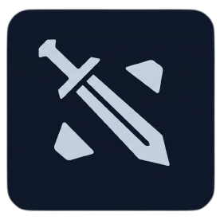
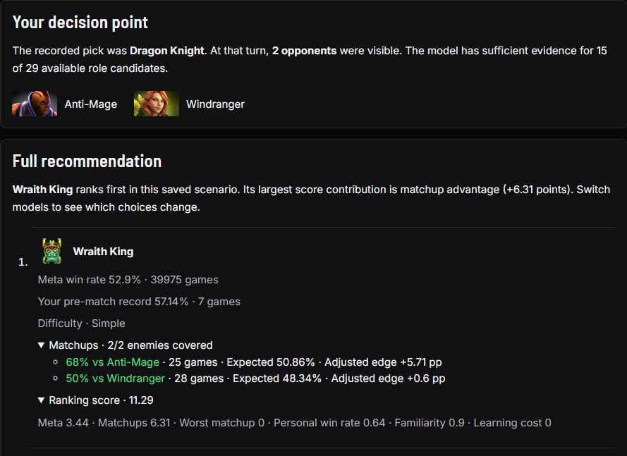
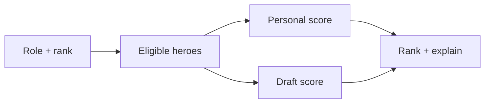
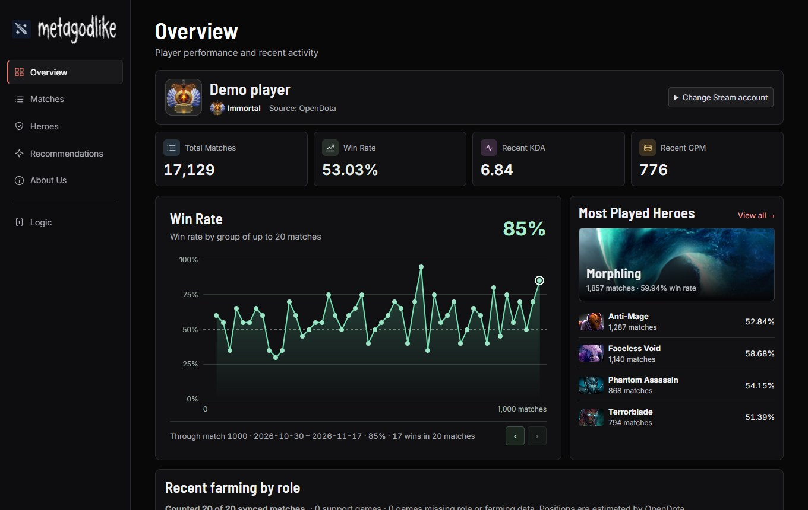
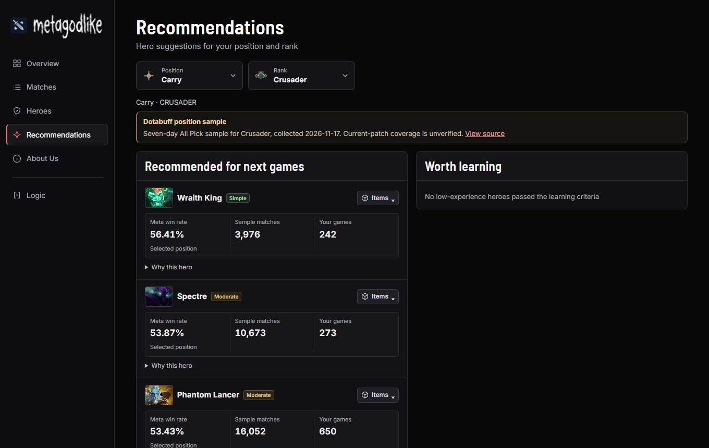
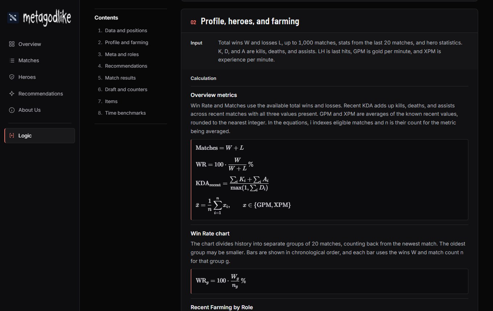
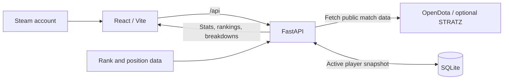

<div align="center">



# metagodlike

**Explainable Dota 2 hero recommendations based on player history, role, rank, and draft matchups.**


[](https://github.com/never-stress-yahu/metagodlike/actions/workflows/ci.yml)

[**Explore a sample draft in your browser**](https://never-stress-yahu.github.io/metagodlike/) · [One-minute tour](#a-one-minute-tour) · [Screenshots](#screenshots) · [What you can do](#what-you-can-do) · [Quick start](#quick-start) · [How it works](#how-it-works) · [Configuration](#configuration)

</div>

---

metagodlike helps Dota 2 players choose a hero for their role, decide which heroes to practice, and review the picks they could have made in a past match. Its recommendation engine turns public match statistics and each player's history into rankings with a visible score breakdown.

## A draft decision in practice

In match **9094375739**, **Sven** ranks first when the model uses only overall hero performance. Sven stays first when the player's history is added. At the moment of the pick, the player could already see **Anti-Mage** and **Windranger** on the opposing team. Once the model scores those matchups, **Wraith King** moves into first place.

| Wraith King score component | Points |
| --- | ---: |
| Overall hero performance | +3.44 |
| Matchups against the two visible opponents | +6.31 |
| Worst-matchup penalty | 0.00 |
| Player's past results | +0.64 |
| Player's familiarity with the hero | +0.90 |
| Learning cost | 0.00 |
| **Total ranking score** | **11.29** |

Most of Wraith King's matchup bonus comes from games against Anti-Mage. In the saved sample, Wraith King won **68% of 25 games** against him, compared with an expected **50.86%** based on both heroes' overall results. The model dampens the contribution of that small sample. [Try match 9094375739 in the demo](https://never-stress-yahu.github.io/metagodlike/) · [How the bonus is calculated](docs/mathematical-model.md#how-matchups-changed-the-top-pick)

[](https://never-stress-yahu.github.io/metagodlike/)

## A one-minute tour

**1. Filter the candidates.** Start with the player's role and skill bracket. Check that each hero has enough qualifying matches and label whether the data covers the current patch or comes from a historical source.

**2. Score the hero for the player.** Combine the hero's meta performance with the player's recent results on that role, how familiar they are with the hero, and how difficult the hero is to learn. Recent games carry more weight, and a small personal sample is pulled toward the meta baseline. A separate **Worth learning** ranking looks for heroes that add useful skills to the player's pool.

**3. Score the pick for a specific draft.** Given a complete pick log, reconstruct which enemy heroes were visible at the player's turn. Remove unavailable heroes and rank up to three alternatives using meta, the player's experience before that match, and both favorable and unfavorable matchups. The interface shows how each factor contributed.

The **Logic** page documents the formulas in English and Russian. [General recommendation scoring](backend/main.py) · [Draft scoring](backend/draft_recommendations.py)

### From evidence to a recommendation



## Mathematical model

**Mathematical foundations** include exponential decay and half-life, logarithmic diminishing returns, statistical shrinkage, weighted averages, and Jaccard set similarity. These determine how the engine handles recency, experience, small samples, and transferable skills. The mathematical document uses **derivatives, partial derivatives, limits, and sensitivity analysis** to explain how the implemented functions respond to changing evidence and parameters.

Each scoring term addresses a specific source of uncertainty or player readiness. The draft score also includes a penalty for the worst observed matchup.

For personal recommendations, population win rate $v$ is shrunk toward 50% according to sample size $n$ and evidence quality $q$. Recent results receive a 30-day half-life, giving weighted games $G$ and weighted wins $W$.

$$
A=\mathrm{round}_2\left(50+(v-50)\frac{n}{n+500}\right),\qquad
p=\frac{50+(A-50)q}{100}
$$

$$
w_i=2^{-a_i/30},\qquad G=\sum_i w_i,\qquad
W=\sum_i w_i y_i,\qquad P=\frac{W+40p}{G+40}
$$

Here $a_i$ is match age in days and $y_i$ is 1 for a win or 0 for a loss. Only the preceding 90 days on the selected hero and position contribute to $W$ and $G$. The estimate $P$ blends the population baseline with the player's recent results. With $p=0.52$, four weighted wins in five weighted games produce 55.1%.

For a draft, each visible opponent has a sample-adjusted matchup edge $E_e$ relative to an expected win rate $b_e$ based on both heroes' overall strength in the same source. The score rewards average advantage and penalizes the worst observed matchup separately.

$$
E_e=\mathrm{round}_2\left(100\frac{w_e-n_e b_e}{n_e+50}\right)
$$

$$
R_{\mathrm{draft}}=
M_{\mathrm{meta}}+
\frac{2}{N}\sum_e E_e+
\min(0,E_1,\ldots)+
P_{\mathrm{draft}}+F_{\mathrm{draft}}-C
$$

The terms represent population strength, average matchup advantage, worst-matchup risk, personal results, familiarity, and learning cost. $N$ counts all visible enemies, so missing pair evidence reduces the average contribution. The implementation requires evidence for a majority of visible enemies before scoring the candidate.

[**Read the full mathematical derivation and engineering decisions**](docs/mathematical-model.md) — definitions, all three ranking functions, sensitivity analysis, eligibility rules, draft visibility, validation, and code references. The bilingual **Logic** tab exposes these calculations inside the app.

### Evidence and development

The reproducible evaluation covers **four public player histories and 613 held-out predictions**. A prior weight selected on a separate validation period achieved mean per-player Brier error **0.2488**, compared with **0.2500** for a neutral 50% prediction. One player's result was worse than the neutral baseline. This tests the smoothing component. Three frozen drafts compare population-only, personal, full, and previous-model rankings on the same candidate sets.

[Evaluation and reproducible inputs](docs/evaluation.md) · [Engineering decisions and contributions](docs/development.md)

The browser demo runs the application's React layout, hero cards, team lineups, draft sequence, and bilingual Logic page on saved data. Switch matches and scoring variants to inspect changes without installing the backend.

## Team

Development used substantial AI assistance for implementation, debugging, documentation, and evaluation tooling. The [development record](docs/development.md) distinguishes project direction, collaboration, and assisted implementation.

- **Abdolla Margulan** — Frontend
- **Kaldybekov Arnur** — Backend, scoring logic, and frontend

## Screenshots

| Overview | Recommendations |
| :---: | :---: |
|  |  |
| **Match review** | **Logic** |
|  |  |

The Overview screenshot uses a demo display name. Recommendations shown in screenshots reflect the data available at capture time.

## What you can do

### Track your form by role

**Overview** shows total matches and win rate, recent KDA and GPM, a win-rate chart, and your most-played heroes. Each point on the chart is the win rate for its own group of up to 20 games. The chart uses up to 1,000 available matches.

**Recent Farming by Role** looks at the last 20 games and reports match count, last hits per match, and last hits per minute separately for Carry, Mid, and Offlane. Last hits per minute uses total last hits divided by total time for each role. Matches with missing position or farming data are excluded. In **Heroes**, you can search your pool and sort by games played or win rate.

### Review a match against your own baseline

Open any of the 20 recent matches to see the result, duration, both lineups, and your position when it is available. The comparison table shows your kills, deaths, assists, KDA, GPM, and XPM alongside your average from the other recent matches. Each metric shows how many games contributed to its baseline.

### Choose heroes for your next games or for practice

Select one of the five positions and use your own medal or an available rank override. The app checks the role and size of the available meta sample before ranking heroes. The two lists answer different questions.

| List | What goes into it |
| --- | --- |
| **Recommended for next games** | Meta win rate, your recent results on the hero in that position, familiarity, and hero complexity. Recent results use a 90-day window and give newer matches more weight. |
| **Worth learning** | Heroes with fewer than 20 recorded games that pass the meta checks and bring a useful skill, such as initiation or ally saves, or build on a skill from your current pool. |

Each list can show up to five heroes. **Why this hero** opens the reasons, and the card shows the meta win rate, sample size, and your games on that hero. The page labels the scope of the data so you can tell position-specific rates from all-position aggregates.

### Revisit what you knew at pick time

When a public draft log is complete, **Match Details** shows which enemy heroes had been revealed before your pick. In Ranked All Pick, opponents from the same simultaneous phase stay hidden until the phase ends. In Captains Mode, picks follow the recorded order and the page marks which team had last pick.

The app can show **up to three alternatives** for your position. It filters out unavailable heroes, measures their matchups against revealed opponents, and combines those matchups with meta and your experience before the match. The breakdown includes the worst matchup so you can see when a strong counter to one enemy comes with a weakness against another. The score expresses ranking preference in points.

### Inspect builds from start to late game

Open **Items** from a hero card to see the build examples available for that hero and role.

| Stage | What is shown |
| --- | --- |
| **Start** | Observed starting purchases up to 600 gold, arranged as inventory and backpack slots |
| **Mid · 35 min** | An inventory reconstructed from purchases, with components removed when they go into an upgrade |
| **Late · 50+ min** | A completed six-slot inventory from the end of a match lasting at least 50 minutes |

You can inspect individual prices and the total item cost for each available build. Net worth and last-hit targets at **10, 35, and 50 minutes** use the median of the available observations, with the sample size and role coverage shown alongside.

### Read the formulas

The **Logic** tab walks through the inputs, filters, equations, and outputs for each part of the app. It is available in English and Russian, with formulas typeset from LaTeX.

## Quick start

Use **Python 3.12** and **Node.js 24 with npm**. Run the following from the repository root in two terminals.

**Terminal 1 · FastAPI**

```powershell
cd backend
python -m venv .venv
.\.venv\Scripts\python.exe -m pip install -r requirements.txt
.\.venv\Scripts\python.exe -m uvicorn main:app --host 127.0.0.1 --port 8000
```

<details>
<summary>macOS and Linux</summary>

```bash
cd backend
python3 -m venv .venv
.venv/bin/python -m pip install -r requirements.txt
.venv/bin/python -m uvicorn main:app --host 127.0.0.1 --port 8000
```

</details>

**Terminal 2 · React app**

```sh
cd frontend
npm ci
npm run dev -- --host 127.0.0.1 --port 5173
```

Open [metagodlike](http://127.0.0.1:5173/). In **Overview**, enter your Steam32 or Steam64 ID and select **Sync player**. Enable **Expose Public Match Data** in Dota 2 so the provider can read your matches. The app stores one active player per instance. Syncing another account replaces the active profile.

### Explore the saved demo locally

Open the Demo tab after starting the frontend. Its three saved drafts and model comparisons work without the API. The published GitHub Pages build uses this same React interface with the Demo, Logic and About Us routes.

To reproduce the evaluation, run the following from the backend directory.

    python research/evaluate.py

The committed evidence and generated results are checked by GitHub Actions. [Protocol and limitations](docs/evaluation.md)

### Try the recommendation engine offline

With the backend environment installed, run this from `backend/`:

```sh
python demo_recommendations.py
```

The script prints two synthetic recommendation scenarios, **Carry** (`scenarios["1"]`) and **Soft Support** (`scenarios["4"]`). Compare `recommended_for_next_games` and `worth_learning` in each scenario, then look at a hero's `score_breakdown`. The script uses fictional match and patch data and runs without a Steam account or API credentials. [Demo source](backend/demo_recommendations.py)

### Troubleshooting

| What you see | What to check |
| --- | --- |
| The frontend cannot reach the API | Run Uvicorn from `backend/` and check the [local API docs](http://127.0.0.1:8000/docs). The default Vite proxy expects port 8000. |
| The sync has no match history | Check the Steam32 or Steam64 ID and enable **Expose Public Match Data** in Dota 2. |
| **Worth learning** is empty | The list can be empty when the selected role and rank lack usable meta or no eligible low-experience hero meets the score and capability checks. |

## How it works



OpenDota supplies the default public match data. FastAPI normalizes the Steam ID and deduplicates imported matches before saving the active-player snapshot in SQLite. From that snapshot the API builds the overview, role summaries, and personal match comparisons. Recommendation and item endpoints add the relevant hero, matchup, or purchase data before returning results to the React app.

### What depends on the source data

- **Current-patch meta.** Verified recommendations need a recent snapshot for the requested rank and position. Historical results can appear with a source label when verified data is unavailable. The snapshot format and freshness checks are documented in the [meta schema](backend/current_meta_schema.md).
- **Positions and drafts.** Position labels can be provider estimates. A match can have visible lineups while draft coaching is unavailable because the pick log is incomplete.
- **Items and benchmarks.** An example or benchmark can be missing when the provider has too few purchase logs, inventories, or timeline readings. The app labels when the sample includes other positions.

## Configuration

The default local setup works with public OpenDota data. Set optional backend variables in the shell that runs Uvicorn.

| Variable | Where | Purpose |
| --- | --- | --- |
| `OPENDOTA_API_KEY` | Backend | Optional key for OpenDota API requests |
| `STRATZ_TOKEN` | Backend | Optional STRATZ token for provider fallback and position data |
| `CURRENT_META_FILE` | Backend | Path to a verified rank and role snapshot. See the [snapshot schema](backend/current_meta_schema.md) |
| `DATABASE_URL` | Backend | SQLite database location. Defaults to `sqlite:///./dota_helper.db` |
| `FRONTEND_ORIGINS` | Backend | Comma-separated origins to allow for CORS. Defaults to the local Vite URLs |
| `VITE_API_BASE_URL` | Frontend | Alternate API base URL. Defaults to `/api` |

For a deployment with a reverse proxy, serve the Vite build with a fallback to `index.html` for frontend routes and proxy `/api` to FastAPI while stripping the prefix. The default app is designed for one active player per instance.

## Repository map

| Path | Contents |
| --- | --- |
| [`frontend/`](frontend/) | React views, styling, assets, and the bilingual Logic page |
| [`backend/`](backend/) | FastAPI, scoring, role policy, and SQLite persistence |
| [`backend/current_meta_schema.md`](backend/current_meta_schema.md) | Input format and checks for verified meta snapshots |
| [`docs/screenshots/`](docs/screenshots/) | Screenshots of the running UI |
| [`.github/workflows/ci.yml`](.github/workflows/ci.yml) | Frontend lint and build, plus backend tests |

## Verification

Run `npm run lint` and `npm run build` from `frontend/`. With the backend environment active, run `python -m pytest -q` from `backend/`. Backend tests use mocked providers and temporary SQLite databases. GitHub Actions runs these same checks on pushes and pull requests.

With both servers running, open the interactive [FastAPI docs](http://127.0.0.1:8000/docs).

## License

Original project code is available under the [MIT License](LICENSE). Third-party assets and data retain their respective terms. See the [data and asset sources](data/research/README.md).
